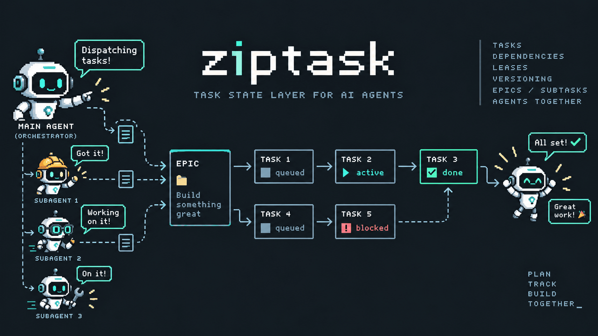

# ziptask

[](https://github.com/zumik3-del/ziptask/actions/workflows/ci.yml)
[](https://github.com/zumik3-del/ziptask/actions/workflows/codeql.yml)
[](https://github.com/zumik3-del/ziptask/actions/workflows/security.yml)
[](https://coveralls.io/github/zumik3-del/ziptask?branch=main)
[](https://github.com/zumik3-del/ziptask/releases)
[](LICENSE)
[](https://bun.sh)

MCP task tracker for AI agents — pure state layer (statuses, deps, leases, versioning) over SQLite.



## Install

One-liner — installs the published binary via the `deploy/` framework (see
[`deploy/app.env`](deploy/app.env) for every knob), seeds a default
`settings.json` and provisions the service:

```bash
# latest release
curl -fsSL https://raw.githubusercontent.com/zumik3-del/ziptask/main/deploy/install.sh | bash

# from a checkout, or pinned to a version
sudo bash deploy/install.sh --version v0.5.4
```

Canonical layout: binary in `/opt/ziptask`, database **and** `settings.json` in
`/var/lib/ziptask/`, deploy state (helpers, hooks, `app.env`) in `~/.ziptask/`.
`--port N` seeds a fresh `settings.json` with `port: N` and points the health
check at it (an existing file is never rewritten); `--dir D` moves the payload,
the config and the database under `D` (config at `D/data/settings.json`) while
the deploy state stays in `~/.ziptask/`; `--version` pins a release and
`--no-service` skips systemd — `bash deploy/install.sh --help` lists them all.
Both `--dir` and `--port` are also persisted into the installed
`~/.ziptask/scripts/app.env` (`INSTALL_DIR`, `DATA_DIR`, `EXEC_START`,
`CONFIG_FILE`, `PORT`) — the file `updater.sh` and `update.sh` reload — so later
updates keep using `D` and `N` instead of the canonical `/opt/ziptask` and
`3005`. A repeat install with the same flags rewrites nothing.

The deploy state is root-owned (`app.env` is `0640 root:<service-group>`,
directories and helper scripts `0750`), so the service account and the account
that runs the update must be in that group. `updater.sh` and `uninstall.sh` are
installed into `~/.ziptask/scripts/`. Every entry point — `install.sh`,
`update.sh` and `updater.sh` — screens `~/.ziptask`, `scripts/`, `hooks/` and
`scripts/app.env` and aborts before changing anything if one of them is a
symlink (dangling included): `cp`, `chown`, `chmod`, `source` and `bash` all
dereference, so a planted link would retarget the work at an arbitrary path.
Inspect the link, remove it, re-run.

The layout, the unit policy and the per-app `app.env` keys are shared with
synaptomind and subagentix and documented once, in
[zumik3-del/synaptomind `docs/DEPLOY-LAYOUT.md`](https://github.com/zumik3-del/synaptomind/blob/main/docs/DEPLOY-LAYOUT.md).

Prebuilt release binaries target Linux x86_64 only. On other platforms (macOS, arm64 Linux) build from source with `bun run build:bin`.

### Service mode

When systemd is detected and running, the installer renders
`/etc/systemd/system/ziptask.service` from the framework's unit template
(`Restart=always`, a bounded `TimeoutStopSec`, and the usual hardening) and
starts it. The unit runs as the invoking account — `SUDO_USER` when the install
went through `sudo` — unless `SERVICE_USER` in
[`deploy/app.env`](deploy/app.env) names another one: it wins over `SUDO_USER`,
and a name that does not exist on the host aborts the install before anything is
written. A shell that is root without `SUDO_USER` (a container, `su -`,
`docker exec -u root`) has no invoking account to inherit: the installer warns,
names `SERVICE_USER`, and continues with a root-run unit — set `SERVICE_USER`
(or install through `sudo` from that account) to keep the service unprivileged;
`SERVICE_USER=root` is the explicit way to say root is intended. Set it (plus
`SERVICE_GROUP` when the group is not the account's own) to run under a
dedicated account. Manage it with:

```bash
sudo systemctl start ziptask
sudo systemctl stop ziptask
sudo systemctl enable ziptask     # auto-start on boot
journalctl -u ziptask -f         # live logs
```

Remove with `bash ~/.ziptask/scripts/uninstall.sh`. It keeps the binary, the
database and the state directory by default; add `--purge` to delete them.

### MCP client config (stdio)

```jsonc
// Claude Desktop / Cursor / opencode — see your client's MCP config (key "mcpServers" in most)
{
  "mcpServers": {
    "ziptask": {
      "command": "/opt/ziptask/ziptask",
      "args": ["--stdio", "--settings", "/var/lib/ziptask/settings.json"]
    }
  }
}
```

Pass `--settings` so the DB path and options come from `settings.json` regardless of the client's working directory — otherwise the DB defaults to `./data/ziptask.db` under the client's cwd. Clients do not expand `~` in `command`/`args`, so substitute the absolute path (`/var/lib/ziptask/settings.json` in the canonical layout).

### MCP client config (remote HTTP)

When the service is running on the same host, point the client at the HTTP endpoint instead:

```jsonc
{
  "mcp": {
    "ziptask": { "type": "remote", "url": "http://127.0.0.1:3005/mcp" }
  }
}
```

The endpoint has no authentication, so keep it bound to `127.0.0.1` (`ZIPTASK_HOST`/`settings.json`). Use a reverse proxy with auth if it must be reachable from other hosts.

## Quick start (from source)

Requires [Bun](https://bun.sh) ≥ 1.4.

```bash
bun install
bun run start          # HTTP server on an ephemeral port (MCP endpoint + /health + experimental /api/tasks and /api/task/:id)
bun run start:stdio    # run over stdio
```

## Build a binary

```bash
bun run build:bin        # produces dist/ziptask
dist/ziptask --version   # prints ziptask and the package.json version
dist/ziptask --stdio     # runs as stdio MCP server
```

## Architecture

Layered by carrier, no framework beyond the MCP SDK:

| Layer | Location | Responsibility |
|---|---|---|
| MCP | `src/mcp/` | Tool schemas, registration, response shaping |
| Service | `src/core/` | Domain rules: transitions, leases, deps, versioning |
| Storage | `src/db/` | SQL (bun:sqlite, WAL) + migrations |
| Entry | `src/index.ts`, `src/server.ts` | Composition root, HTTP transport |

The public task API is MCP, exposed at `POST`/`GET`/`DELETE` `/mcp`, alongside `GET /health` and two experimental REST-style read endpoints, `GET /api/tasks` and `GET /api/task/:id` (the latter kept as an integration endpoint for the subagentix client). No endpoint authenticates. Enumeration is scoped: the enumerating tools require a project slug, while by-id calls stay unscoped — see [Projects](docs/projects.md). See [HTTP endpoints](docs/http-endpoints.md).

## Development

```bash
bun test               # unit tests (per-test temp DBs)
bunx tsc --noEmit      # type check
bun run lint           # biome check src/ scripts/
bun run src/smoke.ts   # MCP end-to-end over HTTP (ephemeral port + temp DB)
```

`CHANGELOG.md` is a short pointer to the current release, updated by hand at release time; the per-release notes are generated on GitHub from the merge commits. There is no changelog script — `release.yml` creates the tag and the Release on `main`.

## Documentation

- [Configuration](docs/configuration.md) — `settings.json`, environment variables, the upgrade path, and backups.
- [HTTP endpoints](docs/http-endpoints.md) — `/mcp`, `/health`, and the two experimental read endpoints `GET /api/tasks` and `GET /api/task/:id`.
- [MCP tools](docs/mcp-tools.md) — the 14-tool reference, projects and scope, task statuses, lease-reap semantics, and lease recovery paths.
- [Projects](docs/projects.md) — what a project is, the slug, the fail-closed scope rule, and the four project tools.
- [Epic → sub-task workflow](docs/epics.md) — declaring epics, attaching sub-tasks, roll-up, closure, and the cross-project constraints.
- [Subagent setup](docs/subagents.md) — install and configure the example orchestrator + subagent agents.

## License

MIT

Please note that this project is released with a [Contributor Code of Conduct](CODE_OF_CONDUCT.md). By participating in this project you agree to abide by its terms.
